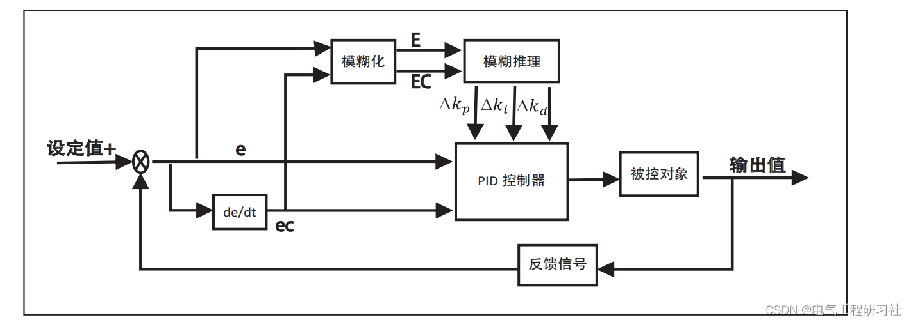
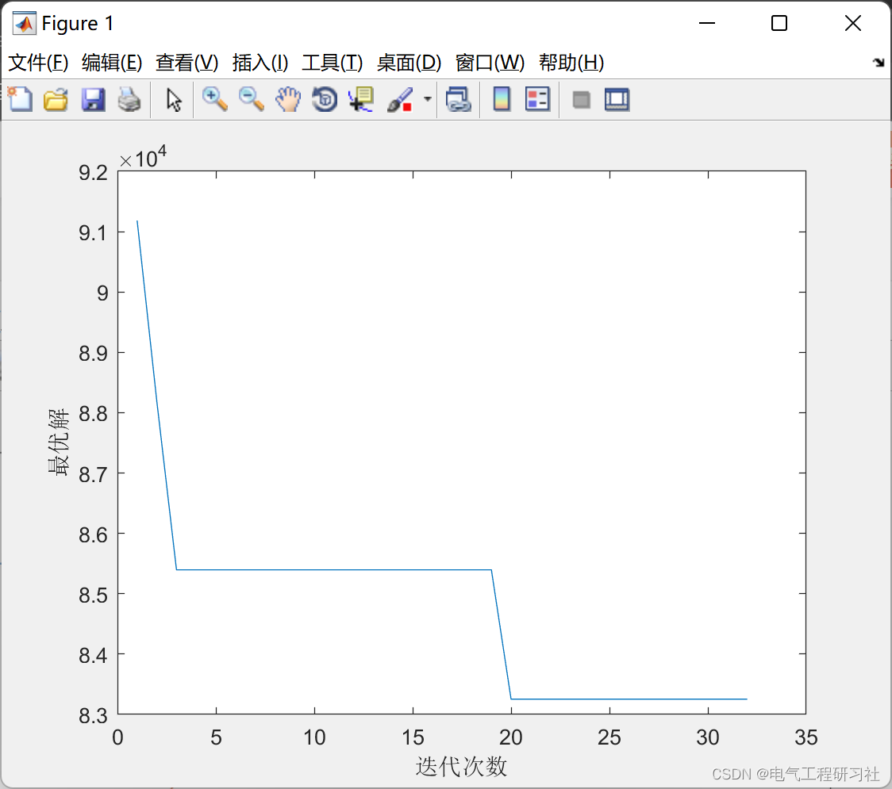
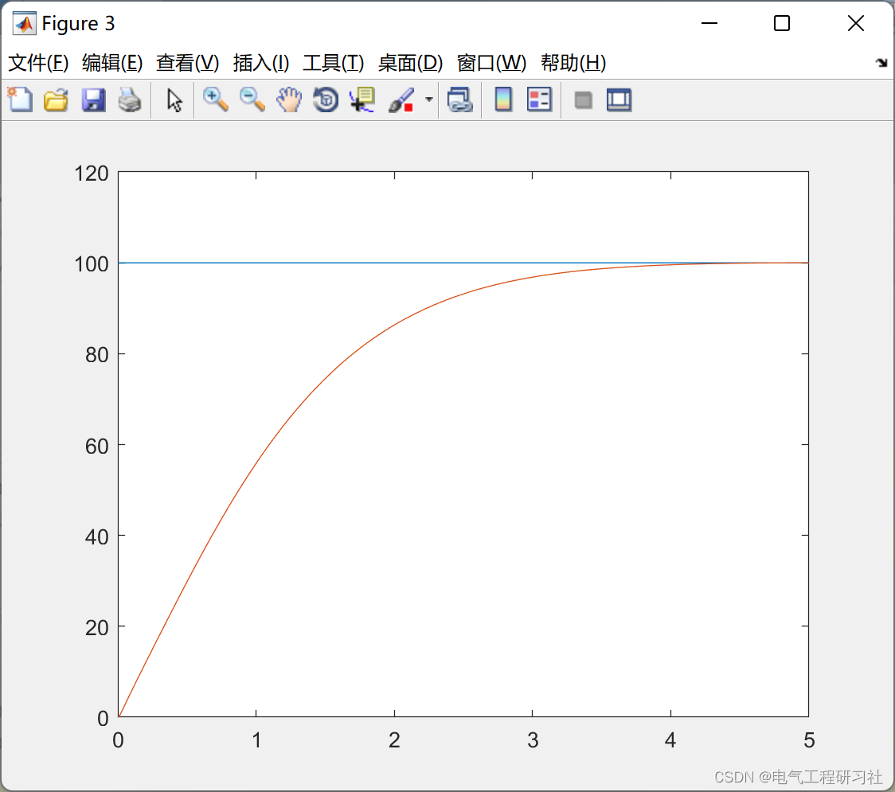
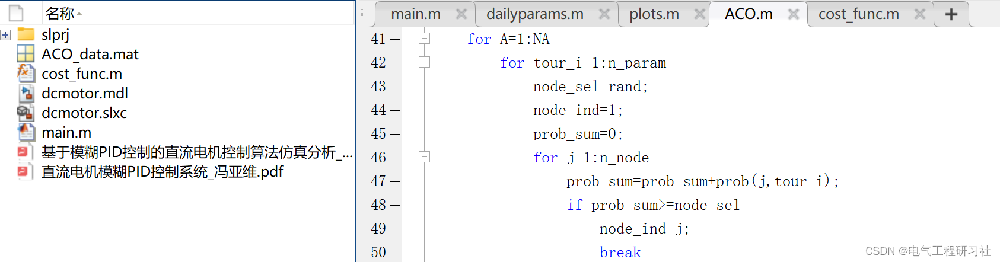

# PID Control of DC Motor Based on Ant Colony Optimization Algorithm (Matlab Implementation)

​  
📋📋📋This article is organized as follows: ⛳️⛳️⛳️​Table of Contents: 1. Fuzzy PID Control Algorithm Research 2. Mathematical Model 3. Ant Optimization Algorithm 4. Running Results 5. MATLAB Code and Article Explanation 6. Final Thoughts PID control regulation is very effective for a large number of industrial control objects, especially for the control of linear constant systems. The quality of its adjustment process depends on the tuning of various parameters in the PID controller. Intelligent control with fuzzy logic has the simplicity and speed of implementation, typically using system error e and error change ec as input variables, thus it possesses characteristics similar to conventional PD controllers. It is known from classical control theory that PD controllers can achieve good system dynamic characteristics, but they cannot eliminate the static error of the system. From the above analysis, it is known that the design of fuzzy PID control mainly involves two aspects. The first is the hybrid structure of fuzzy controller and conventional PID. Secondly, the fuzzy self-tuning technology of conventional PID parameters. The fusion PID composite control block diagram is shown in Figure 1. To meet the requirements of self-tuning PID parameters for different errors e and error variations ∆e, a parameter fuzzy self-tuning PID controller is constructed by modifying the PID parameters online using fuzzy control rules. The design concept of this technology is to first identify the fuzzy relationship between the three PID parameters and the error e and the error change ec, and then continuously detect e and ec during operation, according to the fuzzy control principle.
To modify the three parameters online to meet different controller parameter requirements at different e and ec, thereby ensuring the controlled object has good dynamic and static performance.
Editor
Figure 1: Fuzzy PID Control System Block Diagram
2. Mathematical Models See Section 5.
3. Ant Colony Optimization Algorithm See My Article: Intelligent Optimization Algorithms—Ant Colony Algorithm
4. Run Results Editing
Editing
5. Matlab Code and Article Explanation This article only displays a part of the code, all codes can be found in:
Editing
6. End Notes Theoretical references are from online literature. If any copyright infringement is found, please contact the blogger to delete it.

## Images

<!-- PAYMENT_BLOCK -->

## Get this dataset

- Payment link (Stripe): [Buy now](https://buy.stripe.com/3cs8yP7sY87d0vu9AB)
- Payment QR code: 

<!-- /PAYMENT_BLOCK -->
